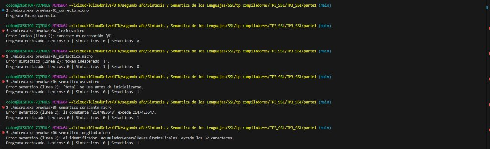
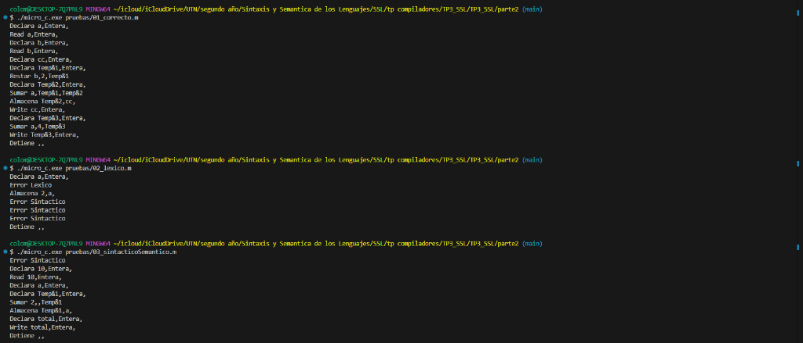

# Trabajo Práctico N.º 3 · Flex, Bison y Compilador de Micro en C

**Universidad Tecnológica Nacional · Facultad Regional Buenos Aires (UTN FRBA)**  
**Materia:** Sintaxis y Semántica de los Lenguajes (SSL)  
**Curso:** K2002 · **Ciclo lectivo:** 2026  
**Integrantes:** *[Completar con Nombre, Apellido y Legajo de los integrantes del grupo]*

---

## Parte 1 · Analizador de Micro con Flex y Bison

### 1. Cómo se resolvió

Se implementó un analizador léxico, sintáctico y semántico completo para la gramática del lenguaje **Micro**. Todo programa válido comienza con la palabra reservada `inicio`, contiene una lista de una o más sentencias terminadas en `;` y finaliza con `fin`. Las sentencias admitidas son asignaciones (`:=`), lecturas por entrada estándar (`leer` con una lista de identificadores) y escrituras por salida estándar (`escribir` con una lista de expresiones). Las expresiones combinan identificadores, constantes enteras, paréntesis y los operadores aditivos `+` y `-`.

1. **Análisis léxico ([micro.l](parte1/micro.l)):** Flex lee el flujo de caracteres y agrupa los lexemas en tokens. Las reglas para las palabras reservadas (`inicio`, `fin`, `leer`, `escribir`) se ubican antes de la regla general de identificadores (`{LETRA}({LETRA}|{DIGITO})*`) para que tengan prioridad en caso de coincidencia de igual longitud, mientras que la regla de coincidencia más larga asegura que un lexema como `inicio2` sea reconocido correctamente como `ID`. Los espacios, tabulaciones y saltos de línea actúan como separadores y actualizan automáticamente el contador `yylineno`.
2. **Análisis sintáctico ([micro.y](parte1/micro.y)):** Bison solicita tokens bajo demanda invocando a `yylex()` y construye el árbol de derivación en forma ascendente (LALR(1)). Las repeticiones expresadas con llaves en la EBNF de cátedra se modelan mediante **recursión a izquierda** (`lista_sentencias`, `lista_identificadores`, `lista_expresiones` y `expresion`), lo que garantiza asociatividad a izquierda para la suma y la resta con consumo constante de pila, mientras que la regla `primaria -> '(' expresion ')'` permite alterar la precedencia mediante paréntesis.
3. **Comunicación entre Flex y Bison:** Flex incluye el encabezado generado `micro.tab.h` para compartir la codificación de los tokens, el tipo `%union` (`yylval`) y la estructura de posiciones (`yylloc`). Para los tokens con carga semántica (`ID` y `CONSTANTE`), Flex duplica dinámicamente el lexema en `yylval.texto`, y Bison libera de forma segura dicha memoria tanto en las reducciones normales como durante el descarte de símbolos por error mediante directivas `%destructor`.
4. **Análisis semántico:** Las acciones semánticas se ejecutan al reducir cada producción relevante. Se mantiene una Tabla de Símbolos dinámica que registra los identificadores que ya recibieron un valor válido (mediante `leer` o mediante el lado izquierdo de una asignación cuya expresión derecha resultó semánticamente válida) y se invocan tres rutinas semánticas de validación estática.

---

### 2. Rutinas semánticas implementadas

Se implementaron **3 rutinas semánticas** en [micro.y](parte1/micro.y) para controlar restricciones sensibles al contexto y de representación que la Gramática Independiente del Contexto (GIC) no puede expresar por sí sola:

| Rutina semántica | Qué verifica | Ejemplo rechazado |
| :--- | :--- | :--- |
| `verificar_uso` | Todo identificador utilizado como operando dentro de una expresión debe haber recibido previamente un valor mediante una sentencia `leer(...)` o una asignación `:=` válida. | `escribir(total);` sin inicialización previa de `total`. |
| `verificar_constante` | Toda secuencia de dígitos debe poder representarse dentro del rango de un entero de 32 bits con signo (`<= 2147483647`). | `escribir(2147483648);` |
| `verificar_longitud` | Todo identificador debe respetar la longitud máxima de 32 caracteres estipulada en la especificación del lenguaje Micro (`TAMLEX = 32 + 1`). | `acumuladorGeneralDeResultadosFinales := 10;` (36 caracteres). |

---

### 3. Errores personalizados y recuperación

* **Error léxico personalizado:** Si el escáner encuentra un carácter ajeno al alfabeto de Micro (como `@`), emite por `stderr` el diagnóstico indicando el número de línea exacto y el carácter inválido (`Error lexico (linea N): caracter no reconocido '...'`), incrementa el contador de errores léxicos y retorna el símbolo especial `YYerror` a Bison para evitar que ese mismo carácter provoque un falso mensaje de error sintáctico adicional.
* **Error sintáctico personalizado:** Se redefinió `yyerror()` utilizando `%locations` (`yylloc.first_line`) y `yytext` para informar explícitamente qué token inesperado rompió la estructura gramatical y en qué línea ocurrió (`Error sintactico (linea N): token inesperado '...'`), distinguiendo también el caso de fin de archivo prematuro (`fin de archivo`). Además, la producción `sentencia -> error ';'` con `yyerrok` implementa recuperación en modo pánico sincronizando en el siguiente punto y coma para continuar analizando el resto del archivo.
* **Error semántico personalizado:** Cada rutina semántica informa la línea exacta, el lexema involucrado y la causa específica del rechazo (`se usa antes de inicializarse`, `la constante '...' excede 2147483647` o `el identificador '...' excede los 32 caracteres`).

---

### 4. Manual de usuario

Ubicarse en la carpeta `parte1` y compilar con `make` (o invocando directamente `bison`, `flex` y `gcc`):

```sh
bison -Wall -d -o micro.tab.c micro.y
flex -o lex.yy.c micro.l
gcc -std=c11 -Wall -Wextra micro.tab.c lex.yy.c -o micro
```

Para ejecutar los casos de prueba incluidos en `parte1/pruebas/`:

```sh
./micro pruebas/01_correcto.micro
./micro pruebas/02_lexico.micro
./micro pruebas/03_sintactico.micro
./micro pruebas/04_semantico_uso.micro
./micro pruebas/05_semantico_constante.micro
./micro pruebas/06_semantico_longitud.micro
```

El ejecutable devuelve código de salida `0` si el programa Micro es válido, `1` si es rechazado por errores léxicos, sintácticos o semánticos, y `2` ante errores de invocación o memoria.

---

### 5. Pruebas y pantallas (Parte 1)

| Archivo de prueba | Contenido (`.micro`) | Salida obtenida |
| :--- | :--- | :--- |
| [01_correcto.micro](parte1/pruebas/01_correcto.micro) | `inicio`<br>`  leer(a, b);`<br>`  cc := a + (b - 2);`<br>`  escribir(cc, a + 4);`<br>`fin` | `Programa Micro correcto.` |
| [02_lexico.micro](parte1/pruebas/02_lexico.micro) | `inicio`<br>`  a := 2 @ 3;`<br>`  escribir(1);`<br>`fin` | `Error lexico (linea 2): caracter no reconocido '@'.`<br>`Programa rechazado. Lexicos: 1 \| Sintacticos: 0 \| Semanticos: 0` |
| [03_sintactico.micro](parte1/pruebas/03_sintactico.micro) | `inicio`<br>`  a := (2 + );`<br>`  escribir(1);`<br>`fin` | `Error sintactico (linea 2): token inesperado ')'.`<br>`Programa rechazado. Lexicos: 0 \| Sintacticos: 1 \| Semanticos: 0` |
| [04_semantico_uso.micro](parte1/pruebas/04_semantico_uso.micro) | `inicio`<br>`  escribir(total);`<br>`fin` | `Error semantico (linea 2): 'total' se usa antes de inicializarse.`<br>`Programa rechazado. Lexicos: 0 \| Sintacticos: 0 \| Semanticos: 1` |
| [05_semantico_constante.micro](parte1/pruebas/05_semantico_constante.micro) | `inicio`<br>`  escribir(2147483648);`<br>`fin` | `Error semantico (linea 2): la constante '2147483648' excede 2147483647.`<br>`Programa rechazado. Lexicos: 0 \| Sintacticos: 0 \| Semanticos: 1` |
| [06_semantico_longitud.micro](parte1/pruebas/06_semantico_longitud.micro) | `inicio`<br>`  acumuladorGeneralDeResultadosFinales := 10;`<br>`fin` | `Error semantico (linea 2): el identificador 'acumuladorGeneralDeResultadosFinales' excede los 32 caracteres.`<br>`Programa rechazado. Lexicos: 0 \| Sintacticos: 0 \| Semanticos: 1` |



---

## Parte 2 · Análisis del Compilador de Micro realizado en C

### 1. Compilación del código entregado en clase

El código fuente del compilador descendente recursivo (ASDR) de Micro provisto por la cátedra se encuentra en [parte2/micro_c.c](parte2/micro_c.c) y se compila generando el ejecutable `micro_c` (`micro_c.exe` en Windows):

```sh
cd parte2
gcc -std=gnu99 -Wall micro_c.c -o micro_c
```

> **Nota sobre los argumentos de entrada:** El programa principal verifica que el nombre de archivo pasado por línea de comandos tenga extensión `.m` y una longitud máxima de 20 caracteres (`TAMNOM = 20 + 1`).

---

### 2. Ejemplos en Micro y pantallas de funcionamiento (Parte 2)

Se prepararon los 3 ejemplos solicitados en la carpeta `parte2/pruebas/`:

#### Ejemplo 1: Programa correcto ([parte2/pruebas/01_correcto.m](parte2/pruebas/01_correcto.m))
```micro
inicio
    leer(a, b);
    cc := a + (b - 2);
    escribir(cc, a + 4);
fin
```

#### Ejemplo 2: Programa con error léxico ([parte2/pruebas/02_lexico.m](parte2/pruebas/02_lexico.m))
```micro
inicio
    a := 2 @ 3;
    escribir(a);
fin
```

#### Ejemplo 3: Programa con error sintáctico y semántico ([parte2/pruebas/03_sintacticoSemantico.m](parte2/pruebas/03_sintacticoSemantico.m))
```micro
inicio
    leer(10);
    a := (2 + );
    escribir(total);
fin
```

A continuación se muestra la captura de la ejecución real de las pruebas en la terminal de MinGW64/Bash:



---

### 3. Análisis en lenguaje natural del funcionamiento ante cada error

#### A. Cómo funciona y por qué se produce el Error Léxico (`02_lexico.m`)
El analizador léxico del compilador en C funciona como un Autómata Finito Determinístico guiado por una matriz de transición de estados en la que cada fila representa el estado actual del reconocimiento y cada columna clasifica el carácter leído del archivo (letra, dígito, operador, paréntesis, espacio, fin de archivo u «otro»).

Al analizar la sentencia `a := 2 @ 3;`, el compilador reconoce sin inconvenientes el identificador `a` (declarándolo en la Tabla de Símbolos), el operador de asignación `:=` y la constante `2`. Sin embargo, cuando el analizador sintáctico de expresiones consulta cuál es el próximo token para saber si sigue un operador `+` o `-`, el escáner lee el carácter `@`. Como `@` no pertenece al alfabeto válido del lenguaje Micro, cae en la categoría de carácter desconocido («otro») estando en el estado inicial del autómata. La tabla de transiciones conduce directamente al estado de rechazo léxico y el compilador informa **`Error Lexico`**.

Lo más interesante es el efecto colateral que se observa inmediatamente después: como el compilador en C no descarta la sentencia ni limpia el estado del token fallido cuando ocurre un error léxico, el procedimiento que analiza la expresión interpreta que después del `2` no hay ni un `+` ni un `-`, por lo que da por terminada la expresión prematuramente y emite la instrucción `Almacena 2,a,`. A continuación, cuando la sentencia intenta verificar el punto y coma final obligatorio, se choca primero con el token de error léxico que había quedado pendiente y luego con los tokens remanentes (`3` y `;`) fuera de lugar, provocando una cascada de tres mensajes de **`Error Sintactico`** consecutivos.

#### B. Cómo funciona y por qué se producen los Errores Sintácticos y Semánticos (`03_sintacticoSemantico.m`)
El compilador en C utiliza un **Análisis Sintáctico Descendente Recursivo (ASDR)** donde cada símbolo no terminal de la gramática tiene su propio procedimiento en C, y las decisiones se toman de forma predictiva observando un único token por adelantado (gramática LL(1)). A su vez, las rutinas semánticas encargadas de administrar la Tabla de Símbolos y emitir el código de la Máquina Virtual están intercaladas de forma rígida dentro de esos procedimientos. En `03_sintacticoSemantico.m` se observan tres fenómenos clave:

1. **Interacción entre error sintáctico y acción semántica inválida en `leer(10);`:**  
   La gramática establece que la instrucción `leer` debe recibir una lista de identificadores (variables donde almacenar los valores ingresados). Cuando el procedimiento correspondiente espera hacer coincidir un identificador pero el escáner le entrega la constante numérica `10`, la verificación sintáctica falla e imprime **`Error Sintactico`**. Sin embargo, el procedimiento no detiene su ejecución tras el fallo sintáctico, sino que invoca inmediatamente a la rutina semántica de procesamiento de identificadores tomando el texto crudo que quedó en el buffer (`"10"`). Como resultado de esta falta de aislamiento entre sintaxis y semántica, el compilador da de alta el número `"10"` en la Tabla de Símbolos como si fuera el nombre de una variable entera (`Declara 10,Entera,`) y emite la instrucción inválida `Read 10,Entera,`.

2. **Omisión de diagnóstico sintáctico y corrupción semántica en `a := (2 + );`:**  
   Dentro de los paréntesis, tras reconocer la constante `2` y el operador `+`, el analizador sintáctico invoca al procedimiento encargado de reconocer el segundo operando (una expresión *primaria*, que solo puede comenzar con un identificador, una constante o un paréntesis de apertura). Al encontrarse con el paréntesis de cierre `)`, dicho procedimiento no halla ninguna opción válida en su selección; pero en lugar de reportar un error sintáctico, simplemente retorna en silencio sin haber cargado ningún dato en el registro semántico del operando derecho. Acto seguido, el procedimiento de la expresión invoca a la rutina semántica que genera la suma infija (`GenInfijo`) pasándole ese registro vacío o con basura de memoria, lo que produce la instrucción defectuosa `Sumar 2, ,Temp&1` (con el segundo operando en blanco) y recién después consume el paréntesis de cierre `)`.

3. **Ausencia de control semántico de inicialización previa en `escribir(total);`:**  
   Desde el punto de vista léxico y sintáctico, `escribir(total);` está perfectamente formada. Desde el punto de vista semántico, en cambio, constituye un error porque se intenta mostrar el valor de la variable `total` sin que jamás haya recibido un dato previo (ni por lectura ni por asignación). El compilador en C no detecta este problema porque su única rutina de control sobre la Tabla de Símbolos (`Chequear`) aplica una política de **declaración implícita en la primera aparición**: cada vez que ve un identificador nuevo —sin importar si está del lado izquierdo de una asignación recibiendo un valor o dentro de una expresión siendo leído— simplemente lo agrega a la Tabla de Símbolos, emite `Declara total,Entera,` y genera `Write total,Entera,`. Este comportamiento contrasta directamente con el analizador construido con Flex y Bison en la **Parte 1**, donde la rutina semántica `verificar_uso` distingue entre la definición de una variable y su utilización como operando, impidiendo usar variables no inicializadas.
